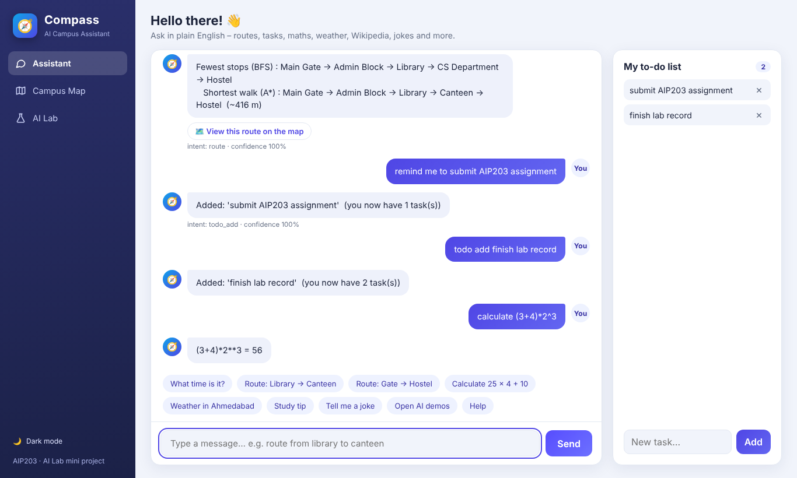
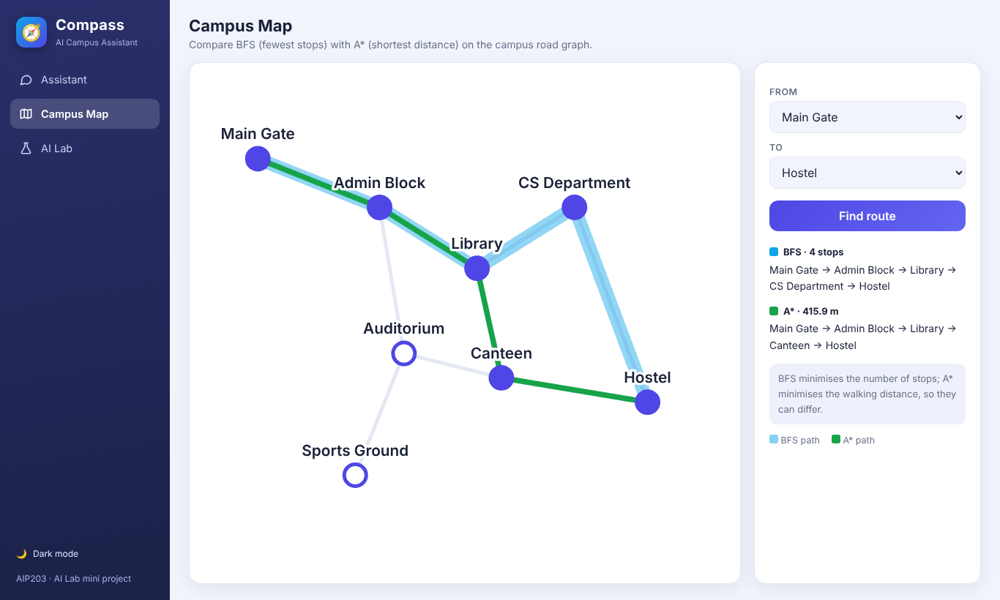
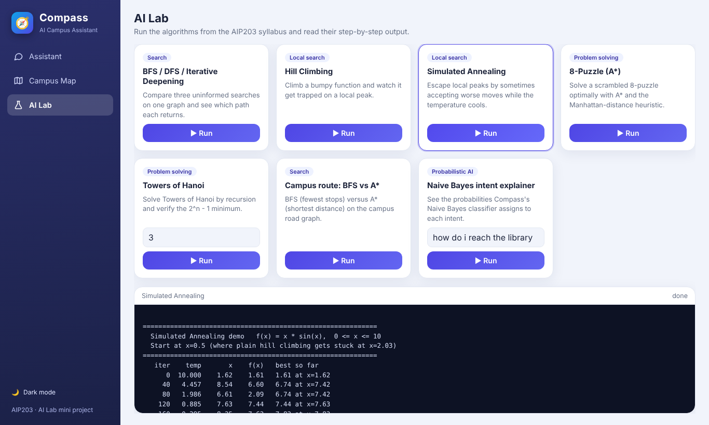
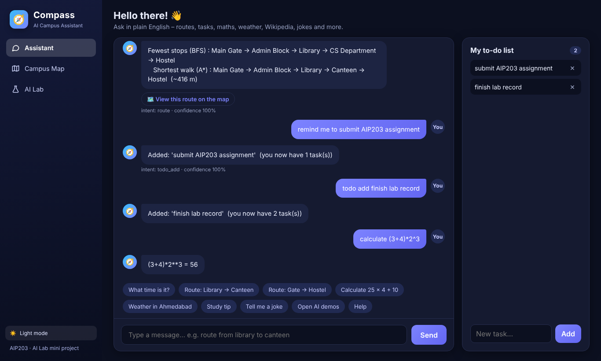
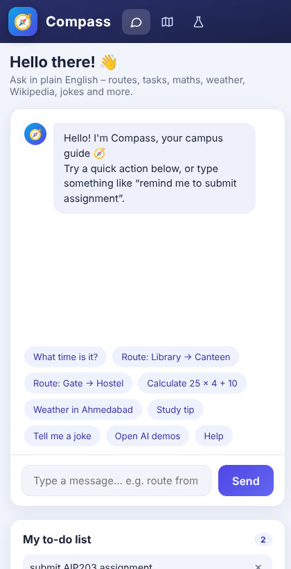

# 🧭 Compass – AI Campus Assistant

Like a compass, it shows the way – around the campus and through the AIP203 syllabus.

> **Course:** AIP203 – Artificial Intelligence Lab (1 credit, L-T-P 0-0-2)
> **Project:** Mini Project – Build a Virtual Assistant
> **Assistant topic:** Campus Virtual Assistant for college students
> **Student:** Divyankar Raj  |  **Roll No.:** 2025KUAD3040
> **Submitted to:** Dr. Pooja Sharma

Compass is a virtual assistant with a modern web interface. You talk to it in plain English; it works out
*what you mean* with a **Naive Bayes classifier written from scratch**, then helps with campus routes,
tasks, maths, weather and Wikipedia. It also contains an **AI Lab** that runs the algorithms from the
course syllabus (BFS, DFS, IDS, A\*, Hill Climbing, Simulated Annealing, 8-Puzzle, Towers of Hanoi).

It needs **only Python** – no packages, no internet (except for the optional Wikipedia command).

## Screenshots
| Assistant | Campus Map (BFS vs A\*) |
|---|---|
|  |  |
| **AI Lab** | **Dark mode** |
|  |  |

The interface is responsive and also works on a phone-sized window:



## Table of Contents
1. [Features](#features)
2. [Syllabus Mapping](#syllabus-mapping)
3. [How It Works](#how-it-works)
4. [Project Structure](#project-structure)
5. [Installation and Usage](#installation-and-usage)
6. [Example Commands](#example-commands)
7. [Testing](#testing)
8. [Limitations and Future Scope](#limitations-and-future-scope)
9. [Documentation](#documentation)
10. [References](#references)

## Features
| Area | What you can do |
|---|---|
| **Assistant chat** | Natural sentences or short commands; shows the detected intent and confidence |
| **Campus Map** | Pick two places and compare the **BFS** route (fewest stops) with the **A\*** route (shortest distance) on an interactive map |
| **To-do list** | Add and remove tasks from chat or from the side panel; saved in `data/todos.json` |
| **Calculator** | Safe expression evaluator (uses Python's `ast`, never `eval`): `(3+4)*2^3`, `sqrt(16)+pi` |
| **Weather** | Simulated report for any city (no API key needed – clearly labelled as simulated) |
| **Wikipedia** | Two-sentence summary (needs internet and the optional `wikipedia` package) |
| **Utilities** | Time, date, jokes, study tips |
| **AI Lab** | Seven runnable algorithm demos with step-by-step output |
| **UI** | Light/dark theme, responsive layout, typing indicator, keyboard friendly |
| **Terminal mode** | Everything also works with `python main.py --cli` |

## Syllabus Mapping
| Syllabus item | Where in the project |
|---|---|
| DFS, BFS, Iterative Deepening Search | `assistant/ai_demos/search_demos.py` |
| Simulated Annealing | `assistant/ai_demos/simulated_annealing.py` |
| Hill Climbing | `assistant/ai_demos/hill_climbing.py` |
| A\* | `assistant/features/campus_nav.py` (routes), `assistant/ai_demos/puzzle8.py` |
| 8-puzzle problem | `assistant/ai_demos/puzzle8.py` |
| Towers of Hanoi | `assistant/ai_demos/hanoi.py` |
| Bayesian reasoning (Naive Bayes) | `assistant/intent.py`, `assistant/ai_demos/bayes_demo.py` |
| **Virtual assistant (CO3)** | `assistant/core.py`, `assistant/webui.py`, `assistant/web/index.html` |

## How It Works
```
 Browser (index.html) ──HTTP/JSON──▶ webui.py ──▶ core.detect()  ──▶ intent.py (Naive Bayes)
        ▲                                │                 │
        │                                ▼                 ▼
   chat · map · lab                 core.respond()  ──▶ features/  (route, todo, calculator, weather, wiki, ...)
                                         │
                                         └──────────▶ ai_demos/  (BFS, DFS, IDS, A*, HC, SA, 8-puzzle, Hanoi)
```
**Intent recognition.** 86 labelled example sentences are used to count how often each word appears
in each of 15 intents. For a new sentence with words *w₁ … wₙ* Compass picks the intent *c* that maximises

`P(c) × Π P(wᵢ | c)`

computed with logarithms (no underflow) and Lidstone smoothing (α = 0.1) for unseen words. Probabilities
are normalised, and anything below **30 % confidence** is answered with "I did not understand".
Explicit commands (`todo add …`, `wiki …`, plain arithmetic) are matched by simple rules first (a *hybrid* design).

**Routing.** The campus is a weighted graph. BFS expands level by level (fewest stops). A\* orders nodes by
`f(n) = g(n) + h(n)` with the straight-line distance as the heuristic, so it returns the shortest walk.

The web page is only a front-end: the terminal and the web UI call exactly the same Python functions.

## Project Structure
```
CampusCompass/
├── main.py                       # entry point (web UI by default, --cli for terminal)
├── requirements.txt              # optional packages only
├── README.md  LICENSE  .gitignore
├── assistant/
│   ├── core.py                   # intent detection, dispatch, demo list
│   ├── intent.py                 # Naive Bayes intent classifier
│   ├── webui.py                  # local web server + JSON API (standard library)
│   ├── ui.py                     # coloured terminal output
│   ├── web/index.html            # the whole front-end (HTML + CSS + JS)
│   ├── features/
│   │   ├── campus_nav.py         # BFS + A* on the campus graph
│   │   ├── todo.py               # JSON-backed to-do list
│   │   ├── calculator.py         # safe AST calculator
│   │   ├── weather.py            # simulated weather
│   │   ├── wiki_search.py        # Wikipedia summary
│   │   ├── datetime_feat.py      # time and date
│   │   └── jokes.py              # jokes and study tips
│   └── ai_demos/
│       ├── search_demos.py       # BFS, DFS, IDS
│       ├── hill_climbing.py
│       ├── simulated_annealing.py
│       ├── puzzle8.py            # 8-puzzle with A*
│       ├── hanoi.py
│       ├── route_demo.py
│       └── bayes_demo.py
├── data/todos.json               # saved tasks
├── tests/test_compass.py         # 19 automated tests
└── docs/
    ├── PROJECT_REPORT.md
    ├── VIVA_QA.md
    └── screenshots/              # images used in this README
```

## Installation and Usage
Requires **Python 3.8 or newer**. Check with `python --version`.

```bash
git clone <your-repo-url>
cd CampusCompass

python main.py              # opens the web interface in your browser
python main.py --cli        # terminal version instead
python main.py --port 9000  # use a different port
python main.py --no-browser # start the server without opening a browser
```
The web interface runs on your own computer (`http://127.0.0.1:8000`); press **Ctrl + C** in the terminal to stop it.

Optional extras: `pip install -r requirements.txt` (terminal colours and the `wiki` command).

## Example Commands
```
how do i reach the hostel          route from library to canteen
remind me to submit assignment     todo add finish lab record      todo list      todo remove 1
calculate (3+4)*2^3                sqrt(16) + pi                    what is 12 times 4
weather Ahmedabad                  wiki machine learning            tell me a joke
what time is it                    give me a study tip              demo     help
```
Try a gibberish sentence to see the "not understood" path, and open **AI Lab → Naive Bayes** to watch the probabilities.

## Testing
```bash
python -m unittest discover -s tests -v
```
19 tests cover intent classification, the calculator (including attempts to run code), BFS/A\* results,
the 8-puzzle solver, hill climbing, the to-do list, and the web API (all seven demos are executed end to end).

## Limitations and Future Scope
* Weather is simulated; a live weather API could be connected.
* The intent classifier is trained on a small hand-written corpus, so unusual phrasing may be missed.
* The campus map is a sample graph; real coordinates of a college could be loaded from a file.
* Future work: voice input/output, a Hidden Markov Model for dialogue context, a Wumpus World demo,
  and a bigger training set with a confusion-matrix evaluation.

## Documentation
* [`docs/PROJECT_REPORT.md`](docs/PROJECT_REPORT.md) – abstract, objectives, design, results, conclusion.
* [`docs/VIVA_QA.md`](docs/VIVA_QA.md) – likely viva questions with short answers.

## References
1. G. F. Luger, *Artificial Intelligence: Structures and Strategies for Complex Problem Solving*, 5th Ed., Addison Wesley, 2005.
2. M. Geldard, J. Manning, P. Buttfield-Addison, T. Nugent, *Practical Artificial Intelligence with Swift*, O'Reilly Media.
3. S. Russell and P. Norvig, *Artificial Intelligence: A Modern Approach*, 4th Ed., Pearson.
4. Python documentation – `http.server`, `ast`, `heapq`, `unittest`: https://docs.python.org/3/
